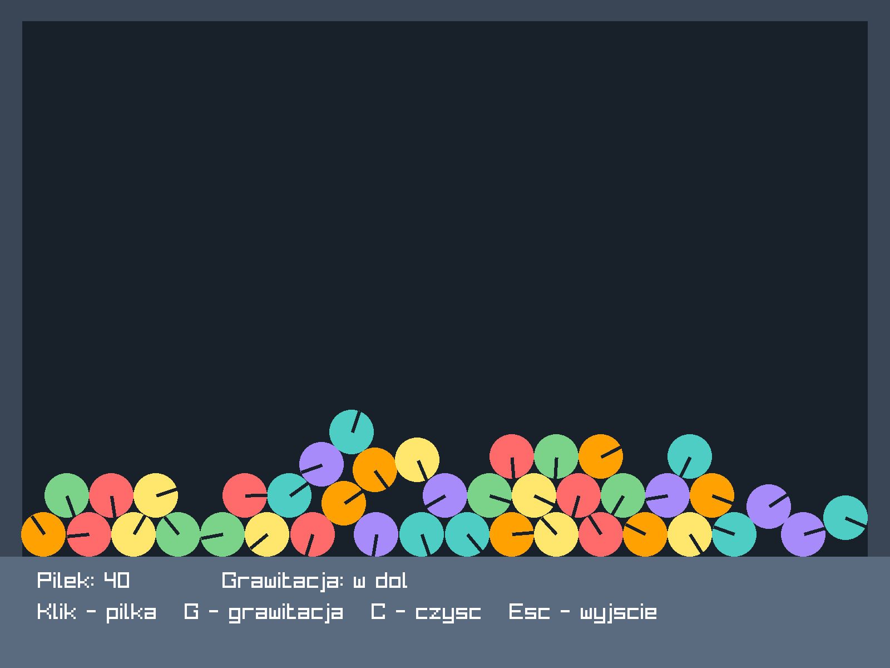
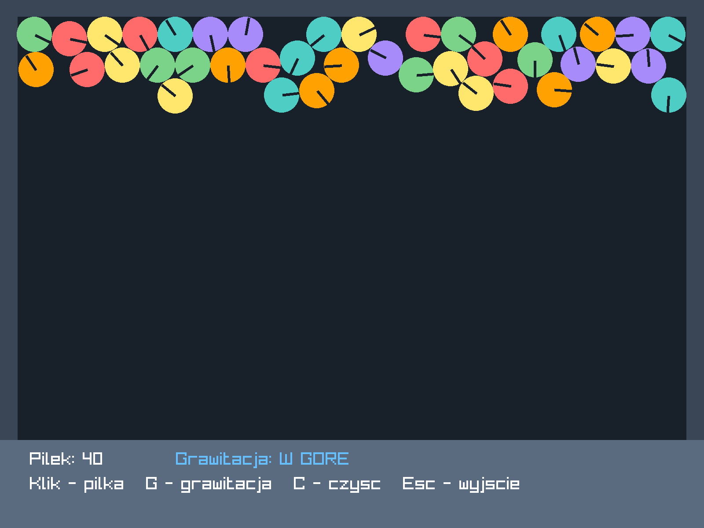

# Piłki z fizyką

Krok 5 tutorialu **„Gry 2D w Ducklingu: pakiety grafika i fizyka, od okna do pierwszej gry”**.
Kliknięcie wrzuca piłkę w miejscu kursora. Piłki spadają, odbijają się i układają na podłodze. Ruch i zderzenia liczy pakiet `fizyka` (port Box2D 3.1.1 do Ducklinga), a gra tylko rysuje.
Do tego pomysł ze slajdu „Grawitacja”: klawisz, który odwraca grawitację.





## Sterowanie

| Wejście | Działanie |
|---|---|
| lewy przycisk myszy | nowa piłka w miejscu kursora |
| G | odwraca grawitację (w dół 10 m/s², w górę 5 m/s²) |
| C | usuwa wszystkie piłki |
| Esc albo zamknięcie okna | wyjście |

## Uruchomienie (macOS)

```sh
./uruchom.sh          # pierwszy raz przygotowuje raylib, grafikę i fizykę (~1,5 min), potem buduje i uruchamia grę
./uruchom.sh testy    # testy świata fizyki, bez okna
```

Wymagania:
* Duckling z `duck` w PATH (sprawdzone na `duckc 0.3-alpha (83882805a 2026-11-20)`, macOS 27.2, Apple Silicon);
* Xcode Command Line Tools (git, make, clang);
* repozytorium [duckling-biblioteki](https://github.com/andr729/duckling-biblioteki), gałąź `paczki-duck`, domyślnie w `~/duckling-biblioteki` (inna ścieżka: `./przygotuj_macos.sh /ścieżka`).

Pierwsza budowa z fizyką trwa około pół minuty, kolejne kilka sekund. Kompilator wypisuje przy fizyce dużo ostrzeżeń „trivially copyable” z modułu nagrań `tasma.dk`; są niegroźne.

## Struktura

```
swiat/    pakiet swiat_pilek: świat gry na pakiecie fizyka (podłoga, ściany, sufit, piłki), bez okna
gra/      pakiet pilki_fizyka: okno, mysz, klawiatura i rysowanie (grafika), pętla gry
testy/    pakiet testy_pilek: 33 sprawdzenia fizyki bez okna, kod wyjścia = liczba błędów
zrzuty/   obrazy do README, tworzone przez grę: PILKI_ZRZUTY=1 gra/.duck_build/dev/pilki_fizyka
przygotuj_macos.sh   raylib 5.5 oraz kopie pakietów grafika i fizyka dla macOS do zewnetrzne/ (poza gitem)
```

## Zgodność z tutorialem

| Tutorial (slajdy 12–20) | Gdzie w kodzie |
|---|---|
| Moduły `fizyka.start`, `fizyka.gra`, `fizyka.kola` | `swiat/src/src.dk`, `gra/src/src.dk` |
| Świat z `start.openGame`, grawitacja `Vec2(0, -10)` w `GameSettings` | `model.otworz` |
| Podłoga: statyczne pudełko 20 m × 1 m (`addBox` z połowami wymiarów) | `model.otworz` |
| Piłki dynamiczne, `restitution = 0.5` | `model.dodajPilke` |
| 50 pikseli na metr, punkt (0, 0) świata w pikselu (400, 500); `toWorld`, `toScreen`, `sizeToPixels` | `model.dodajPilke`, `gra.rysujPilki` |
| Stały krok 1/60 s: `queueTime` z czasem klatki w nanosekundach, potem tyle razy `tick` | `model.krokNs` |
| Kliknięcie: `toWorld` kursora, `addBall`, numer ciała zapisany w `List[gra.BodyNumber]` | `model.dodajPilke` |
| Rysowanie: `gra.lookupBody`, `transform.p`, `toScreen`, `circle` | `model.stanPilki`, `gra.rysujPilki` |
| „Pomysł na grę: klawisz, który odwraca grawitację” (`gra.setGravity`) | `model.odwrocGrawitacje` |

Dodatki:
* ściany i sufit, żeby piłki nie wylatywały z ekranu (także po odwróceniu grawitacji);
* kreska na piłce pokazuje jej obrót (`transform.q`);
* kliknięcie w ścianę albo pod podłogę jest odrzucane z komunikatem, a liczba piłek ma limit 300;
* klawisz C usuwa wszystkie piłki (`gra.destroyBody`);
* po długiej przerwie (np. przeciągnięciu okna) fizyka nie przewija zaległych sekund.

## Czego się nauczyłem o fizyce

* **`gra.setGravity` nie budzi uśpionych ciał** (tak samo jak `b2World_SetGravity` w Box2D). Piłka leżąca na podłodze śpi, więc po samej zmianie grawitacji zostałaby na miejscu. `model.ustawGrawitacje` budzi każdą piłkę przez `gra.setAwake`. Test „po 1 s uśpiona piłka jest już wysoko” bez tej poprawki nie przechodzi: piłka zostaje na y = 0,40 m.
* **Przy grawitacji 5 m/s² odbicia od sufitu trwają około 5 s** (odbicie 0,5), więc piłki układają się tam wolniej niż na podłodze.
* **Pakiet fizyka na macOS** potrzebuje jednej zmiany: `clock_gettime(1, …)` → `clock_gettime(6, …)`, bo na macOS `CLOCK_MONOTONIC` ma numer 6. Zegar służy do pomiarów i nagrań; sam krok fizyki liczy się z czasu, który podaje gra. Zmiany w pakiecie grafika są opisane przy [Łapaczu gwiazd](https://github.com/pixelofsoftware/Duckling_MLPrep/tree/main/lapacz-gwiazd#uwagi-o-macos).

`duck` trzyma jedno środowisko (venv) na nazwę pakietu. Druga kopia projektu na tym samym komputerze kończy się błędem „would overwrite the venv”: zmień w niej `name` w `quackconfig.yaml` albo dodaj `--overwrite`.

## Licencja

MIT. Kopie pakietów `grafika` i `fizyka` w `zewnetrzne/` pochodzą z duckling-biblioteki (MIT; fizyka jest portem Box2D, MIT, Erin Catto), a raylib ma licencję zlib.
